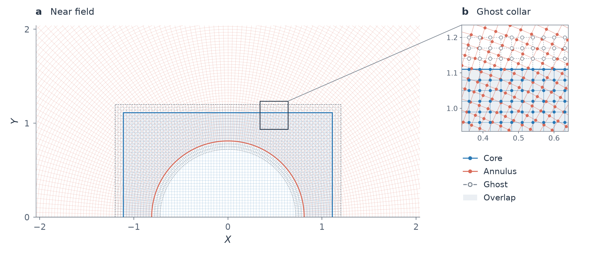
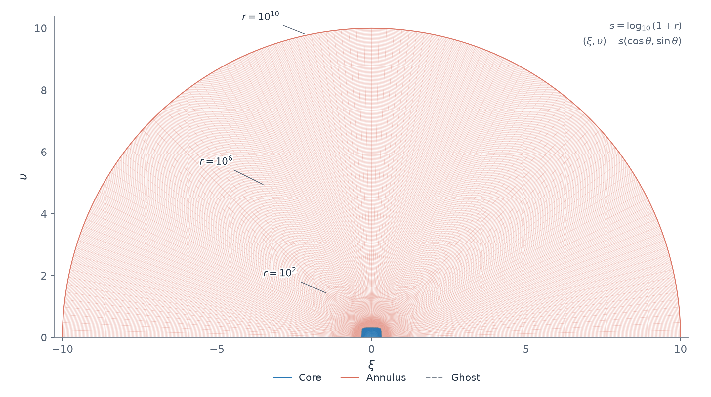

# ipm_cr：单侧 IPM 混合网格求解器

`main` 维护 `ipm_cr`：均匀 Cartesian 张量核心、不含原点的极坐标环带、独立谱 Poisson 求解，以及全部活动点、全部阶段受物理 CFL 约束的显式 RK4。解析背景与残差分离用于控制远场表示及舍入误差。

[运行与数据](docs/USAGE.md) · [架构与接口](docs/ARCHITECTURE.md) · [网格连接](docs/CONNECTION_METHOD.md) · [算法报告](test/ALGORITHM_REPORT.tex) · [分支与复现](REPOSITORY.md) · [验收](docs/VALIDATION.md)

## 网格一览

[](docs/figs/mesh-near.pdf)

近场采用均匀张量核心与极坐标环带：蓝色为核心活动网格，珊瑚色为环带活动网格，灰色为三层 ghost，浅灰底为独立演化的活动重叠区。主图保持原生坐标等比例；右侧放大框对应张量核心顶部的真实连接区，实心点为活动节点，空心点为 ghost。

[](docs/figs/mesh-global.pdf)

核心步长 $h=0.03$，外半径 $R=10^{10}$，两者相差超过 **11 个数量级**。全域图以 $s=\log_{10}(1+r)$ 压缩径向显示，保留全部实际网格线；三个半径标注说明原生尺度，外轮廓是实际最外层网格。该显示变换不代表物理网格含时移动。

点击图片可查看矢量 PDF；[完整图注、配置与复现说明](docs/MESH.md)。

## 安装与短程计算

需要 MATLAB、Python 3；原生内核需要兼容的 C++ 编译器。MATLAB 在项目根目录执行：

```matlab
restoredefaultpath;
addpath('src','tools');
build_ipm_cr_native();       % 从源码在本机生成内核，二进制不入库
opts = ipm_cr.config();      % 完整数值设置的唯一默认入口
[s,ctx] = ipm_cr.init(opts);
[s,info] = ipm_cr.step(s,ctx,.03);  % 一个接受步，且不越过 tauEnd
v = ipm_cr.sample(s,ctx,[0;.3],[0;.1]);
```

`step` 返回一个已接受步；它不是推进到指定时间的循环。`tauEnd` 是该步的上限；完整轨道交给 `ipm_cr.run`。采样只需要匹配的规范坐标查询 `X/Y`，不要求研究区域掩码。`s.W` 是完整中心化密度，`s.eta` 是实际积分余项，`s.rhs` 保存该接受态的完整 RHS 与诊断，`s.scale` 保存尺度及补偿物理时钟。核心完整规范密度为 `s.scale.densityOrigin+s.W.core`，环带同理，原物理密度再乘 `exp(-s.scale.logC_omega)`，不能将 `eta` 当作完整密度。`ctx` 持有网格、原墙参考、方法与私有固定计划；墙采样映射对外只读，计数经 `ctx.stats()` 读取。

独立椭圆演示不推进含时系统：

```matlab
addpath('examples');
[~,~,diagnostic] = poisson_demo();
assert(diagnostic.accepted);
```

## 完整轨道、停止与恢复

用户编辑一份 case，数值方法、运行预算和停止条件分别设置：

```matlab
c = ipm_cr.config('case');
c.run.tauEnd = 10;
c.run.wallSeconds = 600;
c.run.outputDir = 'result';          % 默认输出目录
c.domain.rmax = 1e10;                % 默认共同外半径
c.save.label = 'my_tau10';
[summary,s,ctx] = ipm_cr.run(c);
% 同一源码、初值、方法和目录再次调用，继续最后完整接受态。
[summary,s,ctx] = ipm_cr.run(c);
% 已配好的中层示例：ipm_cr.run('examples/case.json')
```

`wallSeconds` 是本次调用预算，`tauEnd` 是规范时间的绝对目标；`stop.physicalTime` 和默认关闭的 `stop.steady` 提供其他停止条件。稳态只报告完整 F/Q 与连续窗口通过的候选。在输出目录创建 `STOP` 会在接受步边界保存退出。改变源码、初值或方法须使用新目录；`refresh` 不转换跨版本轨道。初值生成、全部控制、状态含义及数据读取见[使用说明](docs/USAGE.md)。

长实验由同一 Python 管理器冻结输入并约束总预算：

```sh
python3 tools/run_explicit_experiment.py start --case examples/case.json
python3 tools/run_explicit_experiment.py status \
  --output "$PWD/result"
```

管理器冻结 `src`、所需工具、选项和初始输入，并核对相对路径的源码身份。单线程串行运行，限制 RSS、可用内存、磁盘和总时间；MATLAB 段成本与监督进程总成本分别记录。`resume` 沿用原任务的绝对截止时间；额外预算必须独立记录，不能自动延长原账本。MATLAB 路径按本机设置，部分资源监控仅适用 macOS。

## 输出与验证

| 输出 | 含义 |
|---|---|
| `summary.json`、`summary.mat` | 实际状态、终点、累计耗时和方法摘要 |
| `latest.json` | 最后接受检查点的槽文件名、序号和 SHA-256 |
| `accepted_0.mat`、`accepted_1.mat` | 交替槽；只读取指针指定且 SHA 正确的槽 |
| checkpoint 的 `state/geometry/explicitOptions/wallOps` | 主态、实际网格、数值选项和原始墙规范；固定计划可冷重建 |
| `history/historyColumns` | 每步实际 CFL、重试、Poisson、I/P/C、峰事件与耗时 |

`ipm_cr.rhs(s,ctx)` 求当前状态的完整耦合 RHS，`ipm_cr.sample(s,ctx,x,y)` 只读重建完整场；带区域掩码的三层研究比较由 `ipm_cr.diag.compare` 负责。未去平移的规范速度和去平移速度分开，`q=W_X`、`F=W_τ`、`Q=F_X` 不与残差导数混用。

只读网格绘图为 `examples/plot_ipm_cr_mesh.m`，通过统一 checkpoint API 读取当前 v2 或显式只读导入历史 v1，不重建 RHS；绘图所需辅助函数随源码提供。

测试从 `tests` 运行，输出写入新的独立目录。原生构建入口在 `tools`，演示与只读绘图在 `examples`；不再把整套求解器放入测试目录。

维护测试只在 [tools/validation.json](tools/validation.json) 登记一份清单：

```sh
python3 tools/run_validation.py --list
python3 tools/run_validation.py --suite quick
python3 tools/run_validation.py --suite full
```

默认套件可在干净克隆准备和运行；MEX 按需从源码构建并核验。昂贵研究和外部历史比较分别显式选择 `research/history`，缺数据记录 skipped。检查完成与精度资格分开报告。

`tests/run_ipm_cr_explicit.m` 是旧研究签名的适配入口，生产调用使用 `ipm_cr.run`。历史脚本和冻结 runtime 按其原身份运行，不为迁移后包生成新的历史资格声明。

## 源码与数值证据边界

`src/+ipm_cr` 是完整的维护源码；不依赖旧 `+ipm/+ipm_c` 包。`config` 管完整数值选项，`pconfig/psolver` 只管独立椭圆系统，`problem` 集中物理初值和规范。初始文件由 [data/initial.json](data/initial.json) 定位并校验 SHA。完整旧算法在 [`legacy/solvers`](https://github.com/bjchen-remote/one_sided_IPM/tree/legacy/solvers)；本地保留旧目录、结果和原型不属于维护源码。

已有短窗自收敛测量和维护等价回归；全局空间阶、完整长轨迹精度以及等误差速度优势仍需分别验证。数值及适用范围见[算法报告](test/ALGORITHM_REPORT.tex)，维护证据见[VALIDATION](docs/VALIDATION.md)与[本地证据索引](docs/EVIDENCE.json)。发布配置、接受态停止/恢复/导出和17项维护检查已通过；完整精度研究另行记录。
