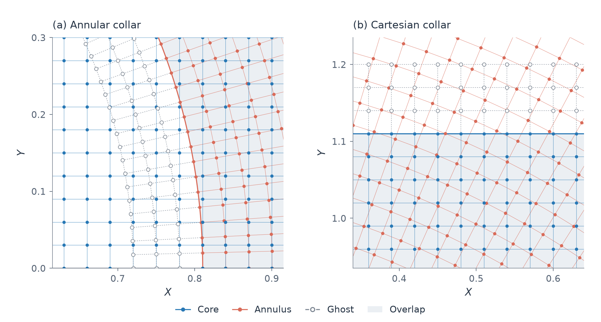
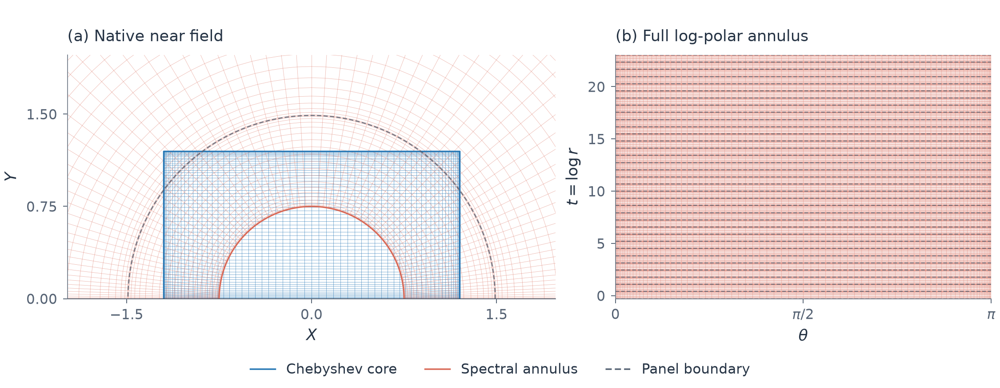

# 混合网格图集

这些图直接读取 `ipm_cr.mesh.build` 和谱网格构造器生成的真实节点，没有推进 PDE，也没有把网格替换成展示用规则采样。近场和连接区使用等比例原生 $(X,Y)$；全域另用明确标注的径向显示变换。蓝色表示 Cartesian 张量网格，珊瑚色表示极坐标网格；灰色虚线表示只参加插值交换的 ghost。


本组图采用已测中层配置：核心步长 $h=0.03$，基准径向请求 385、角节点 129；远区固定重分配参数为 `factor=2, preserveRadius=4, fullRefinementRadius=20`。

| 网格 | 实际尺寸与范围 |
|---|---|
| 输运核心 | 完整 41×81，活动 38×75；完整矩形 $[-1.2,1.2]\times[0,1.2]$ |
| 输运环带 | 截取后 618×129；首圈约 $r=0.720236$，首活动圈约 $r=0.810357$ |
| 全部输运活动自由度 | 82185；包含两侧独立的活动重叠区 |
| 谱 Poisson | 核心 65×65；环带 34 个径向谱片、每片 21 节点，角节点 81，共用接口后径向节点 681 |

## 近场：张量核心与极坐标环带


[下载矢量 PDF](figs/mesh-near.pdf)

核心区使用等间距张量网格，环带不含原点。左侧总览保留原窗口 $[-2.04,2.04]\times[0,2.04]$，使用等比例的原生 $(X,Y)$；细线保留全部相交网格，较强轮廓标明真实活动边界。两块活动域在重叠区独立演化；边界线并不代表一条逐点匹配的接口。

右侧放大图由总览中的 ROI 框引出，使用已有连接区图右窗：$X\in[0.34,0.64]$，$Y\in[0.935,1.235]$。这是张量核心顶部三层 ghost 所在的真实局部窗口，仍横纵等比例；全部可见活动点以实心点显示，ghost 为空心点，沿用原始掩码。放大只增加一个读图视窗，不改变计算网格。

## 连接区：活动点、重叠与 ghost



[下载矢量 PDF](figs/mesh-join.pdf)

放大视图保留实际节点和三层 ghost。ghost 由另一侧的活动 donor 同时插值填充；两侧活动值不会互相覆盖或投影成同一组自由度。连接方法见 [网格连接说明](CONNECTION_METHOD.md)。

## 全局：径向分布与远区分辨率


[下载矢量 PDF](figs/mesh-global.pdf)

外边界为 $R=10^{10}$。全域图保留全部 618 径向行和 129 角向列，以 $s=\log_{10}(1+r)$、$(\xi,\upsilon)=s(\cos\theta,\sin\theta)$ 显示。短轴标签、角落公式及 $r=10^2,10^6,10^{10}$ 的细引线标注区分显示坐标和原生半径；加强的外轮廓取自实际最外层网格。该图不是物理坐标下的等间距半圆。远区重分配仅改变固定网格的节点分布，不是含时移动网格。

## 独立谱 Poisson 网格



[下载矢量 PDF](figs/mesh-poisson.pdf)

Poisson 求解使用独立的核心 Chebyshev 张量网格与分片对数径向谱环带。其端点聚集不进入输运 CFL；输运步长仍按两个输运活动域及全部显式阶段的真实速度约束。

## 复现

在项目根目录运行，输出使用新的绝对目录：

```matlab
addpath('src','examples');
export_mesh(fullfile(pwd,'results/mesh_export'));
```

```sh
python3 tools/plot_mesh.py \
  --input "$PWD/results/mesh_export/mesh.mat" \
  --output "$PWD/results/mesh_plots"
```

Python 需要 NumPy、SciPy 和 Matplotlib ≥3.8。PNG 和矢量 PDF 随图集保存；复现脚本还生成 SVG。导出和绘图脚本随源码管理；图外记录保存精确配置、输入和脚本 SHA、坐标变换及绘图范围。默认绘图配置对应已测的中层方法，不把这套可视化视作所有计算的默认分辨率，也不新增精度阶资格。

图像来源、精确配置与 SHA 见 [figures.json](figs/figures.json)。MAT 几何输入保存在本地 `results/mesh_export_20261022/mesh.mat`，可用上述导出命令重新生成。
