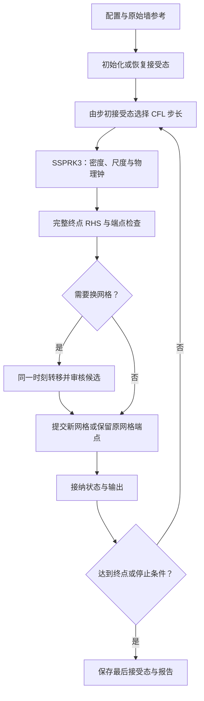

# 极坐标 IPM：整体架构

`ipm_c` 将动态重标度后的密度输运写成一个空间右端函数，用直接 CFL 选择步长，以 SSPRK3 推进；时间端点通过检查后，再尝试调整径向网格并保存结果。先看“推进什么、一次右端怎样闭合、一个时间步怎样完成”，再阅读具体离散公式。

本文讲模块职责与调用关系。完整推导见[算法细节](/Users/cbjin/Documents/one_sided_IPM/time_evolution/IPM_C_ALGORITHM_DETAILS.md)，实验及其源码归属见[验证记录](/Users/cbjin/Documents/one_sided_IPM/time_evolution/IPM_C_VALIDATION_NOTES.md)，命令与数据接口见[使用说明](/Users/cbjin/Documents/one_sided_IPM/time_evolution/IPM_C.md)。源码核对日期为2026年10月21日，包含当前已采用的原点负半径延拓。

## 1. 求解对象：一个演化场，一个即时流场

在重标度坐标 \((X,Y,\tau)\) 中，求解

\[
-\Delta\Psi=R_X,\qquad \mathbf U=(-\Psi_Y,\Psi_X),
\]
\[
R_\tau=-\mathbf V\cdot\nabla R+c_\omega R,
\qquad \mathbf V=\mathbf U+c_l(X,Y)+(c_r,0).
\]

密度 \(R\) 随时间演化；流函数 \(\Psi\) 由当前密度的 Poisson 方程即时确定。三个规范速率 \(c_l,c_\omega,c_r\) 由当前墙观测的变化率约束确定。它们共同给出当前密度变化率，再交给时间积分器。

计算域是重标度上半圆 `0≤r≤1e10, 0≤θ≤π`。墙上流函数为零，外弧流函数用半平面镜像 Green 核计算；密度采用开放边界输运。尺度、水平位移和物理钟随密度同步更新，用于恢复物理量。规范时间 \(\tau\)、物理时间 \(t\) 和程序墙钟耗时各有不同含义。

实际存储为

\[
R=R_\circ+W,\qquad R_\circ=R(0,\tau),\qquad W(0,\tau)=0.
\]

`state.rho` 存中心数组 \(W\)，原点标量存于 `scale.densityOrigin`；输出兼容字段 `rho` 表示完整 \(R\)。这项分解保护大常数背景上的小空间变化。源 \(q=D_XW\)、流场、规范速率和诊断 \(Q=D_XW_\tau\) 都是派生量，不独立推进。`Q/rho_xt` 也不是物理混合导数 \(\rho_{xt}\)。

## 2. 生命周期：初始化、推进、换网格、输出



新运行读取固定墙参考，建立实际网格，采样解析初值，并计算初始完整右端。恢复运行读取检查点中的主态、网格、参考和控制状态，再重建空间算子与右端缓存。之后两者进入相同的推进循环。

原始 I/P/C 规范参考在整条轨道中固定；换网格用的面积参考和退避计数随成功提交或候选拒绝更新。这两类参考承担不同职责。

## 3. 一次空间右端：流场固定，规范与输运耦合

空间入口是 `ipm_c.spatial.evaluate(W,ops,scale)`。在当前网格上，它返回 \(W_\tau\)，并通过 `flow` 返回原点变化率、流场、规范速率和诊断。

|次序|已知量 → 计算结果|方法与职责|
|---|---|---|
|① 密度微分|\(W\) → \(q=D_XW,D_YW\)|局部差分；原点用 Cartesian 多项式拟合|
|② 即时流场|\(q\) → \(\Psi,\mathbf U\)|角向正弦 FFT，径向三次 B 样条 Galerkin，缓存直接 LU|
|③ 规范与输运闭合|\(W,\mathbf U\) → 三个规范速率及未分离原点的变化率|固定本次 Darcy 场，规范小系统反复调用 WENO 输运|
|④ 原点分离|上述变化率 → \(W_\tau,R_{\circ,\tau}\)|维持唯一零中心原点，与完整密度方程线性等价|
|⑤ 诊断与审计|实际变化率与合成速度 → \(Q\)、CFL、残差|供端点检查、步长选择、换网格与输出使用|

第③步内部存在反馈：试探 \((c_l,\delta)\) 决定合成输运速度，WENO 给出密度变化率，墙观测计算该变化率对积分、峰值和质心的影响，规范求解器据此更新试探值。收敛后再恢复 \(c_\omega,c_r\)。这轮探测复用同一个 Darcy 场，Poisson 不随试探值重复求解。

I/P/C 分别是固定墙区间上的梯度积分、墙梯度峰和平方梯度质心。它们约束观测变化率；密度不在每步结束后额外投影到目标峰值或积分。规范中的 Newton／阻尼负责求坐标速率，时间推进仍为显式 SSPRK3。

三个离散算子各有用途：`D_X` 生成 Poisson 源及 `Q`；固定墙插值与墙微分生成规范观测；WENO 上风导数生成输运变化率。细节从[规范消元](/Users/cbjin/Documents/one_sided_IPM/time_evolution/IPM_C_ALGORITHM_DETAILS.md#gauge)和[输运公式](/Users/cbjin/Documents/one_sided_IPM/time_evolution/IPM_C_ALGORITHM_DETAILS.md#transport)展开。

## 4. 一个时间步：重复计算与缓存复用

`ipm_c.evolve.advance` 根据步初接受态的最大输运率与 \(|c_\omega|\) 选择直接 CFL 步长，并受最大步长、剩余规范时间和剩余物理时间限制。生产默认 `CFL=.4,maxDt=.2,minDt=1e-10`。这是步初规则；终点 CFL 另行记录。

共享 `ipm.evolve.stepRk` 对 \(W,R_\circ\)、尺度和位移使用同一组 SSPRK3 阶段。每个需要新计算的阶段都调用完整空间右端；新端点也完整评估一次，用于检查和下一步缓存。物理钟以高、低位补偿累计小增量。

|空间评估位置|正常命中缓存时的处理|
|---|---|
|步初接受态|复用上一端点的精确 RHS 缓存|
|第一、第二内部阶段|分别计算新的完整 RHS|
|新端点|计算新的完整 RHS，供检查与下一步复用|

因此，固定网格的正常一步需要 **3次新的完整 RHS／Poisson**；步初缓存失效时需要4次。候选换网格的额外评估另计。当前没有局部截断误差估计或失败步长重试；数值阶段失败时，运行层保存最后接受态并停止。阶段公式与物理钟实现见[时间推进细节](/Users/cbjin/Documents/one_sided_IPM/time_evolution/IPM_C_ALGORITHM_DETAILS.md#time)。

## 5. 换网格：在同一个端点更换表示

显式端点通过检查后，换网格模块才检查源的 `.1/.2/.5` 峰值超水平集面积是否变化达到20%，以及当前首间距是否需要细化。它保留角轴与节点数，按完整源特征调整径向核心和拉伸尾部。

候选上只转移 \(W\)，保持 \(R_\circ\)、尺度、位移和时钟为该时刻的值。随后重建算子，重新求 Poisson、规范、输运和 \(Q\)，检查几何、积分／墙峰跳变、强残差，以及相同新坐标上的速度和 \(Q\) 差。全部通过才提交候选及其新缓存。

候选可采用几何阻尼；拒绝候选时保留刚完成的时间端点，并记录待处理请求和退避计数。换网格回滚与时间步重试是两个不同过程。具体触发公式和门槛见[换网格细节](/Users/cbjin/Documents/one_sided_IPM/time_evolution/IPM_C_ALGORITHM_DETAILS.md#remesh)。

## 6. 状态、缓存与持久化的边界

|对象|内容|有效范围与恢复方式|
|---|---|---|
|演化主态|\(W,R_\circ\)、对数尺度、位移、规范时间及物理钟|随 SSPRK3 更新；检查点保存，物理钟另含补偿低位|
|几何与控制状态|实际网格、固定规范参考、面积参考、退避计数、规范热种子|网格随换网格更新，热种子与监测计数随推进更新，固定规范参考不变；检查点保存|
|派生场|源、流函数、速度、规范速率、\(Q\)、CFL 和审计|当前主态确定；恢复时重新计算|
|固定几何缓存|样条基、源重构映射、模态矩阵与 LU、Green 几何|同一实际网格跨 RHS 复用；换网格或新进程后重建|
|单次 RHS 预备|固定 \(W\) 的 WENO 导数、墙观测闭包|仅服务本次规范探测，不跨阶段状态复用|
|接受态 RHS 缓存|场变化率、标量变化率与规范热种子|精确匹配主态、尺度和几何后供下一步首阶段使用；恢复时重建|

每个接受步的20列标量先追加到内存轨道，发布时批量落盘；场切片按输出周期保存实际接受端点。`data.mat` 是轨道与帧目录，大场在 `data_frames`，同一实际网格在 `grids` 去重保存。切片、网格、尺度和时钟配套解释。

检查点采用两槽轮换与 SHA 指针，保存主态、配置、历史和控制状态；派生场与 LU 不作为权威主态保存。恢复校验数值源码清单。离线读取经 `ipm_c.data → ipm_c.cartesian → ipm_c.plot` 完成；绘图重采样只处理已保存场。

## 7. 从架构定位到代码

```text
main_c → ipm_c.solve
  ├─ 新运行：ipm_c.initialize
  ├─ 恢复：output.loadCheckpoint → 重建 ops、flow、rhsCache
  └─ ipm_c.evolve.advance
       ├─ ipm.evolve.stepRk → ipm.evolve.flow
       │    └─ ipm_c.spatial.evaluate
       │         ├─ field.derivatives → spatial.poisson
       │         ├─ gauge.measure
       │         ├─ gauge.solve ↔ field.transport
       │         └─ 原点分离、Q、CFL 与审计
       └─ remesh.apply → 候选转移、审核、提交／回滚
返回 solve → 接纳状态、追加标量、按周期输出与检查点
```

|阅读目的|源码入口|细节入口|
|---|---|---|
|运行与恢复|[solve.m](/Users/cbjin/Documents/one_sided_IPM/time_evolution/+ipm_c/solve.m:1)|[恢复约定](/Users/cbjin/Documents/one_sided_IPM/time_evolution/IPM_C_ALGORITHM_DETAILS.md#implementation)|
|完整右端|[evaluate.m](/Users/cbjin/Documents/one_sided_IPM/time_evolution/+ipm_c/+spatial/evaluate.m:1)|[状态与网格](/Users/cbjin/Documents/one_sided_IPM/time_evolution/IPM_C_ALGORITHM_DETAILS.md#state-grid)|
|从源求流场|[poisson.m](/Users/cbjin/Documents/one_sided_IPM/time_evolution/+ipm_c/+spatial/poisson.m:1)|[Poisson 分步求解](/Users/cbjin/Documents/one_sided_IPM/time_evolution/IPM_C_ALGORITHM_DETAILS.md#poisson)|
|输运及原点接缝|[transport.m](/Users/cbjin/Documents/one_sided_IPM/time_evolution/+ipm_c/+field/transport.m:1)|[WENO 与负半径延拓](/Users/cbjin/Documents/one_sided_IPM/time_evolution/IPM_C_ALGORITHM_DETAILS.md#transport)|
|单步与换网格|[advance.m](/Users/cbjin/Documents/one_sided_IPM/time_evolution/+ipm_c/+evolve/advance.m:1)、[apply.m](/Users/cbjin/Documents/one_sided_IPM/time_evolution/+ipm_c/+remesh/apply.m:1)|[时间积分](/Users/cbjin/Documents/one_sided_IPM/time_evolution/IPM_C_ALGORITHM_DETAILS.md#time)、[换网格](/Users/cbjin/Documents/one_sided_IPM/time_evolution/IPM_C_ALGORITHM_DETAILS.md#remesh)|
|字段与物理量解释|[frame.m](/Users/cbjin/Documents/one_sided_IPM/time_evolution/+ipm_c/+output/frame.m:1)、[data.m](/Users/cbjin/Documents/one_sided_IPM/time_evolution/+ipm_c/data.m:1)|[输出与绘图](/Users/cbjin/Documents/one_sided_IPM/time_evolution/IPM_C_ALGORITHM_DETAILS.md#data)|

当前原点延拓已通过对应生产回归；此前完成 τ=200 的冻结06使用旧原点闭合。方法与完成结果按各自源码证据解释，详见[版本与验证记录](/Users/cbjin/Documents/one_sided_IPM/time_evolution/IPM_C_VALIDATION_NOTES.md)。
